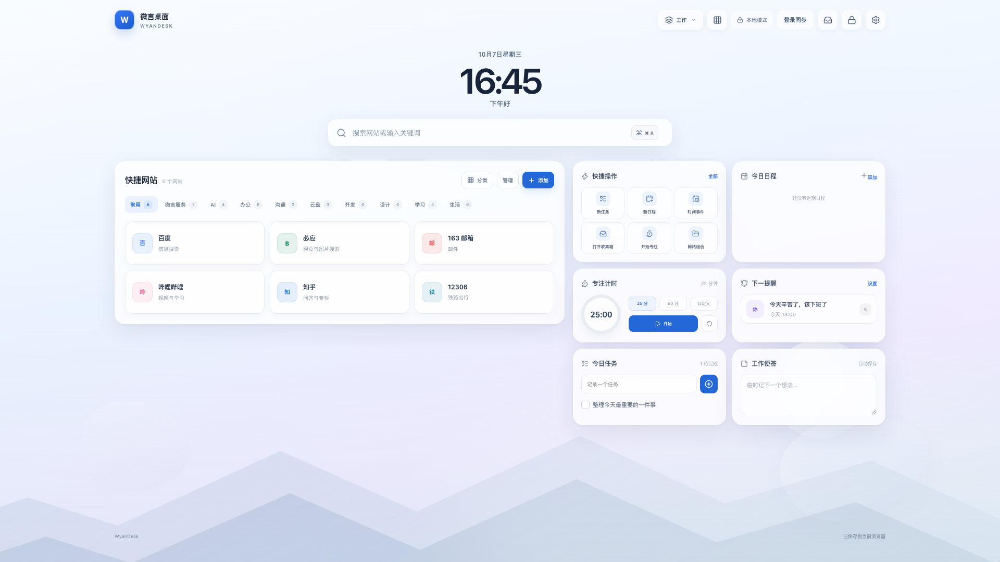

<p align="center">
  
</p>

<h1 align="center">WyanDesk</h1>

<p align="center">A calm, customizable browser desktop for bookmarks, tasks, schedules, notes, focus sessions, and reminders.</p>

<p align="center">
  <a href="https://desk.wyanhub.com"><strong>Live demo</strong></a> ·
  <a href="README.md">简体中文</a> ·
  <a href="https://github.com/lxshwyan/WyanDesk/releases">Extension downloads</a> ·
  <a href="https://gitee.com/lxsh_wyan/WyanDesk">Gitee mirror</a>
</p>



> The official site is live. Its footer shows the site filing number and links to the MIIT filing system. Local mode still requires no account or backend.

Repositories: [GitHub primary](https://github.com/lxshwyan/WyanDesk) · [Gitee China mirror](https://gitee.com/lxsh_wyan/WyanDesk). Development, issues, and pull requests are tracked on GitHub; Gitee is provided for access and distribution in China.

## Highlights

- Local-first data with optional account sync on the official deployment.
- A quieter first view: new desktops show Quick Actions, Today Overview, and Notes by default. Sync status, sign-in, privacy lock, and Settings share one account menu, and an empty inbox no longer occupies header space.
- First-run guidance now states the product's purpose before asking users to choose a starting template: one calm desktop for frequently used sites, today's work, and reminders. It remains optional and can be reopened later from About & Support.
- A unified WyanHub assistant with weighted daily point allowances for guests and signed-in users, a site-wide hard cap, and a guest IP cap to resist simple quota evasion. It includes capability-aware task cards for desktop help, product guidance, step-by-step application operations, tool discovery, general questions, and optional live search. User-facing controls use plain-language automatic matching and network policies, show the maximum point cost before sending, and keep technical model IDs in the admin backend. Answers provide safe formatting, clickable numbered sources, a verifiable answer-basis summary, copy/follow-up actions, and helpful/unresolved feedback rather than raw model chain-of-thought. Product knowledge remains available after the upstream allowance is exhausted.
- Categorized bookmarks, multi-workspace layouts, quick commands, and website groups. The first view shows at most five categories, with the remainder under More; site, category, group, and bookmark-import tools share one management menu. Category deletion explicitly confirms and removes its contained sites instead of silently moving them, while an on-demand group check reports browser-level reachability without claiming continuous uptime monitoring.
- Tasks with either a quick dialog or inline capture, schedules, notes, configurable focus sessions, time events, default workday reminders, custom reminders, sound-backed in-page alerts, optional background system notifications, and opt-in month-calendar, calculator, world-clock, weather, local clipboard, and countdown widgets. Today Overview is enabled by default and reuses existing task, schedule, reminder, and focus data; world clocks use browser time-zone data only and request no location or external API.
- Weather uses a manually selected city and a browser-local 30-minute cache, and calls Open-Meteo only while the widget is enabled. Clipboard reads and writes happen only after a user action; up to 20 entries stay in this browser and are excluded from cloud sync and desktop backups. Countdown reuses the existing time-event data instead of creating a second store.
- A prominent header shortcut for layout editing, an overview-first default widget order, dense two-dimensional per-workspace drag ordering, two distinct width modes (single column and full row), and three height modes. Older saved two-column values remain compatible and render as full-row cards. Desktop cards in the same row stretch to a common height with tighter spacing. One-click controls promote one work card at a time into a three-row primary slot without changing the saved widget order: a left-column card stays in the first left slot, a right-column card stays in the first right slot, and the remaining cards pack around it in reading order. Mobile layouts collapse to one column, show four shortcuts before expansion, and default to Today Overview -> Quick Capture -> work widgets -> Shortcuts; users can switch to a sites-first order in Component Layout. Shortcut cards can also be moved between categories from a right-click or accessible card menu. Card sizes, frequency-based compact settings, multiple 3D-style scenes, custom backgrounds, reduced motion, and crisp native high-resolution layout/type tiers remain adjustable. Ambient motion is limited to small compositor-friendly layers, while grids and dot fields stay static; the desktop clock updates on minute boundaries and the lock-screen second clock runs only while mounted.
- Predictable dialogs, drawers, and menus with top-layer Escape handling, contained Tab focus, focus restoration, keyboard menu navigation, background scroll locking, and larger mobile touch targets.
- Smooth full-screen privacy lock transitions with optional PIN and local-only activity summaries that stay silent after unlock and open only on request from Settings.
- Browser bookmark, ICS, desktop backup, and privacy-safe template import/export.
- Capture the current page as a site, task, or note; save and restore local browser-window sessions. Optional cloud sync can encrypt the complete desktop state in the browser with AES-256-GCM, so the service stores ciphertext only.
- Safer PWA caching that precaches the actual hashed build assets, bypasses API requests, serves the HTML shell only for failed page navigations, and waits for user confirmation before an update takes control.
- Installable PWA and a Chrome / Edge new-tab extension with optional permissions.

## Quick start

Requires Node.js `^20.19.0` or `>=22.12.0`.

```bash
git clone https://github.com/lxshwyan/WyanDesk.git
cd WyanDesk
npm ci
npm run dev
```

Open `http://localhost:8097`. When the optional WyanDesk API is unavailable, the app automatically stays in local mode.

```bash
npm test
npm run typecheck
npm run build
npm run validate:pwa
npm run validate:extension
npm run package:extension
```

## Install as a PWA

- On Android, Chrome, and Edge, open **Settings → Import & backup → Apps & actions** and use the install action when the browser offers it, or choose Install/Add to Home Screen from the browser menu.
- On iPhone or iPad, open WyanDesk in Safari, choose Share, then Add to Home Screen. Other iOS browsers direct users to Safari instead of showing a non-working install button.
- The installed app uses the same local desktop and optional cloud sync. Installation does not grant folder access; files remain available only after the user explicitly selects them.
- Once Settings reports that the basic desktop is ready offline, cached tasks, sites, and notes can reopen without the network. Weather, sync, and the assistant still require connectivity.
- A prepared update is shown as a non-blocking notice and takes control only after the user confirms the reload.

## Docker

```bash
docker build -t wyandesk:local .
docker run --rm -p 8080:8080 wyandesk:local
```

Open `http://localhost:8080`. See [self-hosting](docs/SELF_HOSTING.md) for reverse proxy, PWA, and optional API notes.

## Privacy

WyanDesk stores data in browser `localStorage` by default. It does not include advertising or third-party behavioral analytics. Browser permissions are requested only when a related feature is used. The optional end-to-end sync passphrase is never uploaded or recoverable. When a guest or signed-in user asks the WyanHub assistant a question, only that question, the selected task/network policy, and limited same-route conversation context are sent through the Desk API. Guests also send a random local client ID so the service can enforce a separate daily allowance. The server stores only HMAC-derived subject/network/global keys, quota layer, date, and used points; it does not persist raw client/account IDs, IP addresses, question, answer, or search text. Helpful/unresolved answer feedback stores only the request ID, an HMAC-derived subject or guest-network key, audience, and outcome; the question and answer are not attached. Product questions add matched published knowledge; live search is used only when the selected network policy allows it and the administrator has configured a search service. The assistant does not read desktop cards, sync payloads, or product business data. See the [privacy notes](docs/PRIVACY.md) and [extension store submission guide](docs/EXTENSION_STORE_SUBMISSION.md) for details.

The open-source frontend does not include the WyanHub identity, sync, or assistant backend. All local features remain available without it.

## Contributing

Issues and pull requests are welcome. Please read [CONTRIBUTING.md](CONTRIBUTING.md) and [SECURITY.md](SECURITY.md) first.

## License

[MIT](LICENSE) © 2026 WyanDesk contributors
