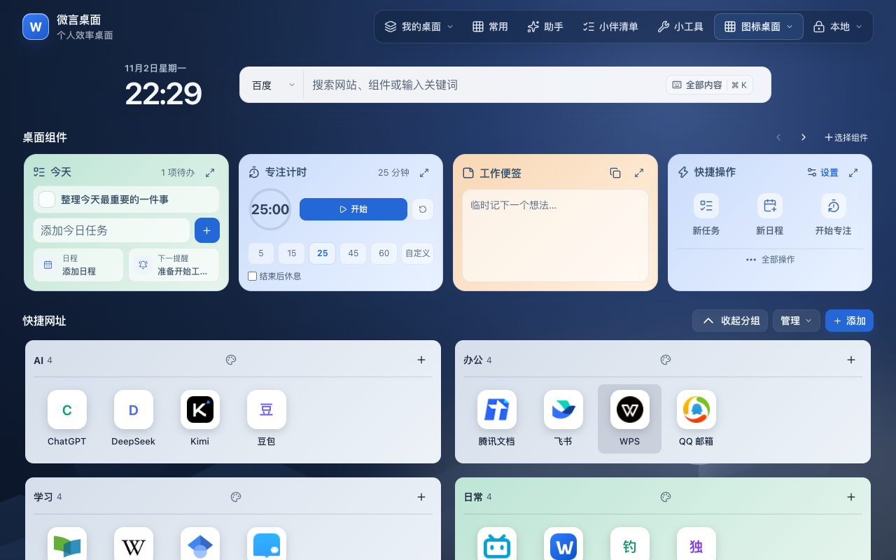

# WyanDesk

A local-first browser desktop for websites, tasks, schedules, notes and focus sessions.

[Live site](https://desk.wyanhub.com/) · [简体中文](README.md) · [GitHub](https://github.com/lxshwyan/WyanDesk) · [Gitee mirror](https://gitee.com/lxsh_wyan/WyanDesk)



## Current version

The public frontend is **0.12.2**, matching the application version of the official website and manual extension ZIP. This repository contains the standalone React app, PWA and Chrome/Edge Manifest V3 extension under the MIT license. GitHub hosts development, issues and pull requests; Gitee mirrors the source for access in China.

The Edge store package is **0.12.2.1**, with a fourth component for store packaging revisions. It was submitted on **November 2, 2026**, with status **In review** at that time. This dated record does not claim certification has passed. The adapter changes manifest metadata and adds Simplified Chinese messages while preserving every runtime file from the 0.12.2 ZIP.

The main branch, GitHub Releases and the extension store are maintained separately. Use the current ZIP links below; [Releases](https://github.com/lxshwyan/WyanDesk/releases) retains historical downloads. See [CHANGELOG](CHANGELOG.md).

## Features

- Navigation, icon, card and minimal modes share saved content. New desktops start with six editable categories and 24 sites. Icon groups and websites expand by default and scroll with the page.
- User-owned favorite groups, local website-name suggestions, drag sorting, cross-category moves and independent copies into favorites.
- Search widget names to open floating tools; distinguish web search, direct URLs and saved sites. `⌘/Ctrl+K` searches tasks, notes and collected content across desktops.
- Optional tasks, schedules, daily overview, multiple notes, focus/rest sessions, month calendar, calculator, unit conversion, world clock, weather, local clipboard, countdowns and reminders. Floating widget views share content with their original cards.
- Focus sessions resume across reloads and same-origin tabs. Each phase waits for the user to begin the next one. Sessions stay outside desktop backup/cloud sync; no alarm runs while the browser is closed.
- Eight environments, local backgrounds, four bundled CC0 photos with attribution, appearance previews, wallpaper positioning, transparent surfaces and per-block backgrounds. Previews save only after Apply.
- New-tab extension, page/link capture, read-later and explicitly selected text. Optional permissions enable bookmark import/export, current-window tab search and local window snapshots restored into new windows.
- Bookmark HTML, ICS and JSON backup migration; offline PWA shell with user-confirmed updates.
- Optional official account sync, history, browser-side end-to-end encryption and WyanHub assistant. The assistant sends user-entered questions and limited conversation context rather than desktop content.

Local features work without an account or backend. Official identity, sync, history and assistant services are outside this repository. See [privacy](docs/PRIVACY.md) and [self-hosting](docs/SELF_HOSTING.md).

## Development

Requires Node.js `^20.19.0` or `>=22.12.0`. The Edge adapter also requires Python 3.

```bash
git clone https://github.com/lxshwyan/WyanDesk.git
cd WyanDesk
npm ci
npm run dev
```

The Gitee clone URL is `https://gitee.com/lxsh_wyan/WyanDesk.git`. Open `http://localhost:8097`; an unavailable backend leaves local features usable.

```bash
npm test
npm run typecheck
npm run build
npm run validate:pwa
npm run package:extension
npm run package:edge-store
```

The source extension manifest is a template. The build injects the version from `package.json`.

## Install or update the extension

Current manual package: **0.12.2**.

- [Official ZIP](https://desk.wyanhub.com/downloads/wyandesk-extension.zip) · [SHA-256](https://desk.wyanhub.com/downloads/wyandesk-extension.zip.sha256)
- [Repository ZIP](public/downloads/wyandesk-extension.zip) · [Repository checksum](public/downloads/wyandesk-extension.zip.sha256)

```text
c9253299fe3fd84b2ac9283a345751cfd0b34185ee9ab2166ada27b3e9779d72
```

1. Extract the ZIP into a permanent folder.
2. Open `chrome://extensions` or `edge://extensions` and enable Developer mode.
3. Choose Load unpacked and select the folder containing `manifest.json`.
4. For manual updates, replace the original folder and choose Reload. Export a desktop JSON backup first.

Chrome/Edge 116+ is required. Required permissions are `activeTab`, `storage`, `identity` and `contextMenus`; `tabs` and `bookmarks` are requested only for relevant actions. There are no content scripts or cookie, form, whole-page or browsing-history reads. Manual packages do not auto-update.

Store and manually loaded extensions have different origins. Export JSON before migration and import into the new installation, keeping the original data. See the [store packaging guide](docs/EXTENSION_STORE_SUBMISSION.md). Website deployments and Git pushes do not submit store updates.

## PWA and self-hosting

On Android, Chrome and Edge, use the account menu's installation entry or the browser install action. On iPhone/iPad, use Safari → Share → Add to Home Screen. Installation grants no folder access. Once cached, the local desktop reopens offline; weather, sync and the assistant still need network access.

`npm run build` creates `dist/`. Serve it with SPA fallback excluding `/api/*`. A standalone Dockerfile is included:

```bash
docker build -t wyandesk:local .
docker run --rm -p 8080:8080 wyandesk:local
```

See [SELF_HOSTING](docs/SELF_HOSTING.md) for caching, HTTPS and optional API boundaries.

## Contributing and license

Please read [CONTRIBUTING](CONTRIBUTING.md) and [SECURITY](SECURITY.md).

[MIT](LICENSE) © 2026 WyanDesk contributors
