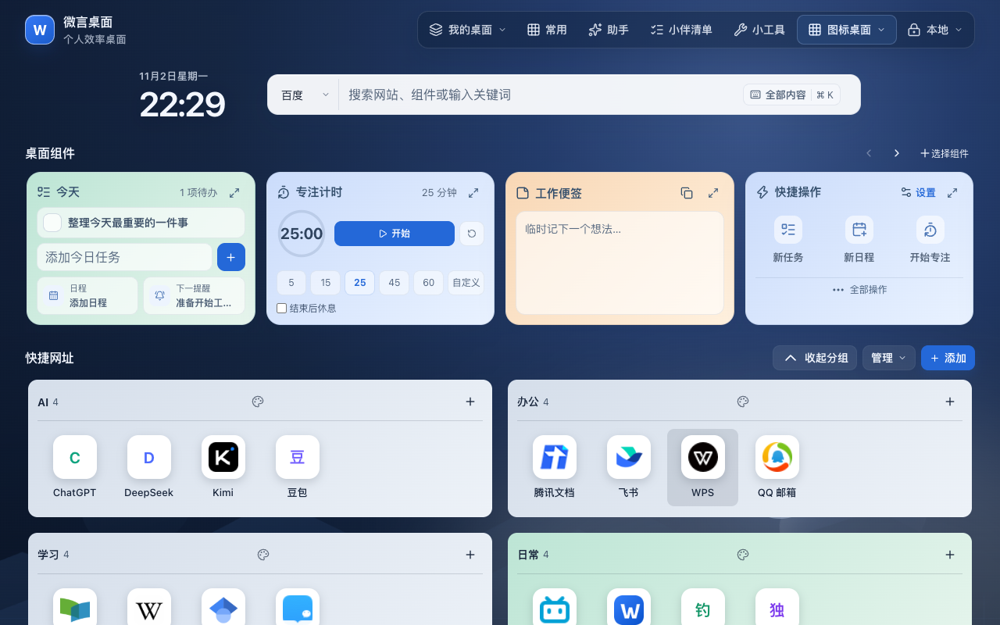

# 微言桌面 WyanDesk

把常用网站、任务、日程、便签和专注计时放进一个可定制的浏览器桌面。

[在线体验](https://desk.wyanhub.com/) · [English](README.en.md) · [GitHub](https://github.com/lxshwyan/WyanDesk) · [Gitee 国内镜像](https://gitee.com/lxsh_wyan/WyanDesk)



## 当前版本

当前公开源码为 **0.12.2**，与官网及官网手动安装扩展的应用版本一致。本仓库提供可独立构建的 React、PWA 与 Chrome / Edge Manifest V3 扩展前端，采用 MIT 许可。GitHub 为主仓库，Gitee 为国内镜像；开发、Issue 和 Pull Request 以 GitHub 为准。

Edge 商店包为 **0.12.2.1**，第四段是商店打包修订。2026 年 11 月 2 日已提交微软审核，当时状态为 **In review**；这是有日期的提交记录，不代表已正式上架。商店包只修改清单并新增简体中文语言消息，运行时文件与 0.12.2 手动安装包一致。

主分支、GitHub Release 和扩展商店分别维护。最新手动安装包见下方入口，[Releases](https://github.com/lxshwyan/WyanDesk/releases) 保留历史版本。版本说明见 [CHANGELOG](CHANGELOG.md)。

## 主要功能

- **四种模式**：轻导航、图标桌面、卡片桌面和极简模式，切换保留内容。新桌面默认图标模式、六个分类和 24 个可删改网站；图标分组及网站默认全部展开，统一随页面滚动。
- **网站与常用分组**：本机建议网站名称、网站目录、拖动排序、跨组移动和独立复制到常用；不抓取目标页面或远程图标。
- **搜索直达**：搜索组件名打开浮窗，区分网页搜索、网址与已收藏网站；“全部内容”或 `⌘/Ctrl+K` 查找跨桌面任务、便签和收集内容。
- **可选组件**：任务、日程、今天概览、多便签、专注与休息、月历、计算器、单位换算、世界时钟、天气、本机剪贴板、倒数日和提醒。组件可排序，浮窗与原卡共享内容，并可拖动、拉伸。
- **专注接续**：同来源标签页共享本机会话，刷新后按截止时间恢复；每阶段结束后等待用户开始下一阶段。浏览器关闭期间不提供系统闹钟，会话不进入桌面备份或云同步。
- **外观**：八套环境、本地图片、四张附带来源许可的 CC0 精选照片，以及外观预览、壁纸位置、透明外观和区块背景；预览只有点击“应用”才保存。
- **浏览器扩展**：工具栏与右键收藏网页、任务、便签、稍后阅读和主动选择的文字；按需授权导入/导出书签、搜索当前窗口标签、保存窗口并在新窗口恢复。
- **迁移与离线**：书签 HTML、ICS、JSON 备份和隐私安全模板；PWA 可离线打开基础桌面，新版本由用户确认后接管。
- **可选云端能力**：官方部署提供账号同步、历史恢复、端到端加密和 WyanHub 助手；助手只发送主动输入的问题与有限对话上下文，不读取桌面内容。

数据默认保存在当前浏览器，无需账号或后端即可使用本机功能。官方账号、云同步、历史恢复和助手后端不包含在本仓库中；服务不可用时本机桌面继续可用。详见 [隐私说明](docs/PRIVACY.md) 与 [自托管指南](docs/SELF_HOSTING.md)。

## 开发与构建

要求 Node.js `^20.19.0` 或 `>=22.12.0`；Edge 商店适配另需 Python 3。

```bash
git clone https://github.com/lxshwyan/WyanDesk.git
cd WyanDesk
npm ci
npm run dev
```

国内也可从 `https://gitee.com/lxsh_wyan/WyanDesk.git` 克隆。打开 `http://localhost:8097`；没有兼容后端时保持本地模式。

```bash
npm test                    # 现有测试
npm run typecheck           # TypeScript 检查
npm run build               # 网页 dist/
npm run validate:pwa        # PWA 与离线缓存检查
npm run package:extension   # 构建、校验并生成手动安装包
npm run package:edge-store  # 从校验后的 ZIP 生成独立商店包
```

`extension/manifest.json` 是模板，构建时从 `package.json` 注入实际扩展版本。

## 安装或更新扩展

当前手动安装包 **0.12.2**：

- [官网下载 ZIP](https://desk.wyanhub.com/downloads/wyandesk-extension.zip) · [官网 SHA-256](https://desk.wyanhub.com/downloads/wyandesk-extension.zip.sha256)
- [仓库内 ZIP](public/downloads/wyandesk-extension.zip) · [仓库内 SHA-256](public/downloads/wyandesk-extension.zip.sha256)

```text
c9253299fe3fd84b2ac9283a345751cfd0b34185ee9ab2166ada27b3e9779d72
```

1. 下载 ZIP 并解压到固定文件夹。
2. Chrome 打开 `chrome://extensions`，Edge 打开 `edge://extensions`，开启开发者模式。
3. 选择“加载已解压的扩展程序”，指向含 `manifest.json` 的目录。
4. 手动版不会自动更新；更新时覆盖原目录，再点“重新加载”。更新前可先导出桌面 JSON 备份。

要求 Chrome / Edge 116+。默认权限为 `activeTab`、`storage`、`identity` 和 `contextMenus`；`tabs`、`bookmarks` 仅在相关操作中按需申请。不注入内容脚本，不读取 Cookie、表单或浏览历史，不抓取整页正文。

商店版和手动加载版来源不同，迁移前先导出 JSON，在新版本导入并保留原数据。见 [扩展商店指南](docs/EXTENSION_STORE_SUBMISSION.md)。网页更新或 Git 推送不会自动提交商店审核。

## PWA 与自托管

Android、Chrome 和 Edge 可从账号菜单“安装与扩展”进入设置首页，或使用浏览器安装入口。iPhone / iPad 使用 Safari“分享 → 添加到主屏幕”。安装不授予文件夹权限，导入只读取主动选中的文件。基础桌面缓存就绪后可离线打开，天气、同步和助手仍需网络。

`npm run build` 生成 `dist/`，可部署到静态主机；SPA 回退需排除 `/api/*`。也可使用独立 Dockerfile：

```bash
docker build -t wyandesk:local .
docker run --rm -p 8080:8080 wyandesk:local
```

更多配置见 [SELF_HOSTING](docs/SELF_HOSTING.md)。

## 项目结构与参与

`src/` 为应用和测试，`extension/` 为 MV3 后台、工具栏及清单模板，`public/` 为 PWA、图标、壁纸和安装包，`scripts/` 为构建及校验，`docs/` 为公开文档。

请先阅读 [贡献指南](CONTRIBUTING.md) 与 [安全策略](SECURITY.md)。

[MIT](LICENSE) © 2026 WyanDesk contributors
